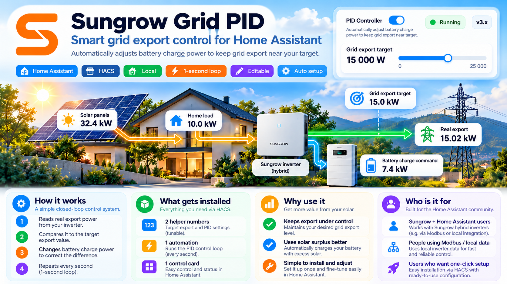

<div align="center">

# ☀️ Sungrow Grid PID

### Smart grid export control for Home Assistant

**Use excess solar energy to charge your battery while regulating power exported to the grid.**



[](https://www.home-assistant.io/)
[](https://hacs.xyz/)
[](https://github.com/EvgenyKrinets/sungrow-grid-pid/releases)
[](LICENSE)

[**Installation**](#-installation) · [**How it works**](#-how-it-works) · [**Configuration**](#-configuration) · [**Troubleshooting**](#-troubleshooting)

</div>

---

## ⚡ What is Sungrow Grid PID?

**Sungrow Grid PID** is a community-built Home Assistant integration that helps regulate grid export by adjusting the inverter's **maximum battery charging power**. It compares your current export reading with the desired grid export target, then changes the charge-power command to reduce the difference.

This is useful for a Sungrow hybrid inverter when solar energy can be divided between the home, grid export, and battery charging.

> **Note:** The illustration above is a conceptual example. Displayed power values are illustrative, not live readings or guarantees of inverter output. This is a simple integral-based controller, not a full proportional–integral–derivative implementation.

## ✨ Features

| Feature | Description |
| --- | --- |
| 🎯 **Grid export target** | Set the desired export power with a slider |
| 🔋 **Battery charging control** | Updates the maximum charge-power entity in Home Assistant |
| 🔁 **One-second adjustment** | Original, user-editable Home Assistant automation |
| 🧩 **Native helpers** | Uses standard `input_number` entities |
| ⏯️ **PID ON/OFF** | Toggle the Home Assistant automation directly from the Lovelace card |
| 🔧 **Editable entities** | Choose the export sensor, battery charge control, and Sungrow scene |
| 🏠 **Local automation** | Runs inside your own Home Assistant instance |
| 📦 **HACS installation** | Install integration files using HACS |

## 🧠 How it works

```text
Solar PV ───┬──► Home consumption
            ├──► Grid export ──► sensor.export_power
            └──► Battery charging ◄── number.battery_max_charge_power
                                          ▲
                                          │
Target (input_number.pid_grid_target) ──► PID automation
                                          ▲
                                          │
Memory (input_number.pid_integral) ◄──────┘
```

Every second, the automation uses the **entity IDs selected in integration settings**:

```text
error = actual_grid_export - export_target
raw_output = previous_output + error * 0.10
charge_command = clamp(raw_output, configured_charge_number.min,
                      configured_charge_number.max)
```

The controller continues adjusting smoothly even for small requested charging powers such as **20–50 W**. It does **not** impose a special cutoff when export falls below target, and it does **not** quantize commands to the UI slider's `step` attribute. Output is rounded to two decimal places and clamped to the entity's minimum and maximum. The default Sungrow number may have a 10 W minimum. Actual accepted command precision depends on the connected integration and inverter.

The target and integral helpers retain their `input_number.pid_grid_target` and `input_number.pid_integral` identifiers. The export and battery entities use the selections saved during setup.

This is an **integral feedback controller**, not a full PID with proportional and derivative terms. Turning it off stops updates but does not automatically clear the inverter's charge limit.

## 📦 Installation

1. In **HACS**, add `https://github.com/EvgenyKrinets/sungrow-grid-pid` as a custom **Integration** repository (if it is not already available).
2. Install **Sungrow Grid PID** and **restart Home Assistant**.
3. Go to **Settings → Devices & services → Add integration → Sungrow Grid PID**.
4. Confirm the pre-filled entity IDs or choose matching entities from the selectors.
5. Complete setup. Existing native PID helpers are preserved; missing ones are created as native Home Assistant input_number entities and validated before setup continues.
6. The installer creates the two native helpers and verifies that both are present. If a helper cannot be registered, setup reports an error instead of silently leaving the PID incomplete.
7. Find **Simple Grid Battery Controller** under **Settings → Automations & scenes**, and the **Sungrow Grid PID** dashboard/card in Home Assistant.

**Before enabling:** verify the automation is loaded, the export reading is valid, the target is within the permitted export limit, and no second PID automation is controlling the same charge-power entity.

### ⚙️ Configuration

Default values match the original Sungrow setup and can be changed through integration settings:

| Setting | Default |
| --- | --- |
| Grid export sensor | `sensor.export_power` |
| Maximum battery charge power | `number.battery_max_charge_power` |
| Scene activated on PID enable | `scene.self_consumption_mode_max_battery_discharge` |
| Grid target helper | `input_number.pid_grid_target` |
| PID integral helper | `input_number.pid_integral` |
| Target range | 0–17,000 W, 1,000 W step |
| Output range | Automatically read from the selected battery charge number's `min` and `max` attributes |
| Feedback gain | 0.10 |
| Update interval | 1 second |

The integration uses an **ordinary editable Home Assistant automation** named `Simple Grid Battery Controller`. It does **not** run the PID calculation through a separate background Python PID loop.

### 🎛️ Dashboard card

The compact `custom:sungrow-grid-pid-card` displays:

- **PID automation** — ON/OFF switch, linked to `automation.simple_grid_battery_controller` by default
- **Grid export target** — slider linked to `input_number.pid_grid_target`
- **Actual grid export** — from `sensor.export_power`
- **Battery charge command** — from `number.battery_max_charge_power`

If your automation has a different entity ID, select the correct `automation.*` entity in the card editor. The same applies to the other entities.

## 🔧 Charging control and cloud response

The controller now uses a **single smooth formula**. Both limits are read from the **battery charge number selected in integration settings**; setup no longer requires a hardcoded 25,000 W maximum:

```text
output_new = clamp(output_old + (export - target) × 0.10,
                   charge_entity.min, charge_entity.max)
```

When export falls below target, the command decreases gradually with no 2 kW threshold, no forced jump to the minimum, and no artificial 100 W quantization. It can calculate and request 20 W, 30 W, 50 W, or other low values when the selected entity supports them.

For example, if the charging control reports `min: 10`, `max: 25000`, `step: 100`, the controller clamps to that entity's actual 10–25,000 W range but does not assume the UI step limits the actual service command. If the service rejects particular intermediate values, check its integration requirements.

**Upgrade behavior:** the installer updates known formulas from earlier project versions in the existing `Simple Grid Battery Controller` automation (including older ID-less copies), backs up `automations.yaml` first and preserves the rest of that automation. Unknown custom formulas are deliberately left unchanged; verify the active automation after updating.

## 🗒️ Hide Activity entries while keeping the history graph

On initial setup or restart, the integration **automatically adds** these three Logbook-only exclusions to simple `configuration.yaml` configurations (and creates `configuration.yaml.sungrow-grid-pid.bak` before making changes). Home Assistant must restart once more for the new Logbook filter to take effect. For complex YAML configurations (including external includes) the installer leaves the file untouched and explains why in the logs. To **keep the Battery max charge power graph** but hide frequent **Activity / Logbook** entries, the configuration is:

```yaml
logbook:
  exclude:
    entities:
      - number.battery_max_charge_power
      - input_number.pid_integral
      - automation.simple_grid_battery_controller
```

Merge this into an existing `logbook:` section if you already have one. Check configuration and restart Home Assistant. Recorder will continue storing the sensor's history, and its history graph will remain available. The installer deliberately does not alter Recorder include/exclude filters, since altering them may remove the graph. This does **not** reduce Recorder database size; it filters Activity/Logbook entries. Older already-open Activity results may require a page refresh.

**Do not put this entity under `recorder.exclude` if you want to preserve the graph.**

### 🛠️ Helper installation repair (v3.0.18)

The earlier installer could write records to Home Assistant's helper storage without actually registering the live `input_number` entities. That left the automation referencing `input_number.pid_integral` or `input_number.pid_grid_target` with **Entity not found**.

The updated installer registers missing native `input_number` entities during setup, preserves existing helpers, and verifies that both exact entity IDs resolve. It also attempts to restore an item already present in helper storage but missing from the runtime. Setup fails with a clear log error if either helper is still unavailable rather than creating a nonfunctional PID automation.

## 🛟 Troubleshooting

| Problem | What to check |
| --- | --- |
| Card says **automation not found** | Confirm the automation exists and its real entity ID matches the card configuration |
| Integration shows a red error | Open **Settings → System → Logs** and check entries mentioning `sungrow_grid_pid` |
| Card still looks old after HACS update | Restart Home Assistant and hard-refresh the browser (Ctrl+Shift+R) |
| No helpers visible | Check integration setup logs for a failed native-helper registration; setup must verify both input_number entities |
| Automation not loaded | Check that `configuration.yaml` includes `automation: !include automations.yaml` and review automation errors |
| PID seems to work in the wrong direction | Verify that positive `sensor.export_power` means exporting power |

## ⚠️ Safety and limitations

- **Always obey your utility export limit** and inverter/battery charging specifications. This software is not an export-limit protection system or certified grid control.
- PID uses frequent entity updates; recorder/history load can grow if the integral helper changes every second.
- If the controller is disabled or Home Assistant goes offline, the last inverter charge limit may remain active.
- The current installer preserves pre-existing helpers and automations instead of deleting or overwriting user-maintained configuration.
- Actual integration behavior can vary with Home Assistant releases and specific Sungrow integrations. Test with supervision before relying on automatic charging decisions.

## 🗑️ Uninstall

Remove **Sungrow Grid PID** from **Settings → Devices & services**, then uninstall its files in **HACS**. Native helpers and editable automations may remain intentionally; remove those separately after ensuring nothing else uses them.

## ❤️ Community

Issues, bug reports, and contributions are welcome:

- [Report an issue](https://github.com/EvgenyKrinets/sungrow-grid-pid/issues)
- [View releases](https://github.com/EvgenyKrinets/sungrow-grid-pid/releases)

---

<div align="center"><sub>Community project for Home Assistant. Not an official Sungrow or Home Assistant product.</sub></div>
