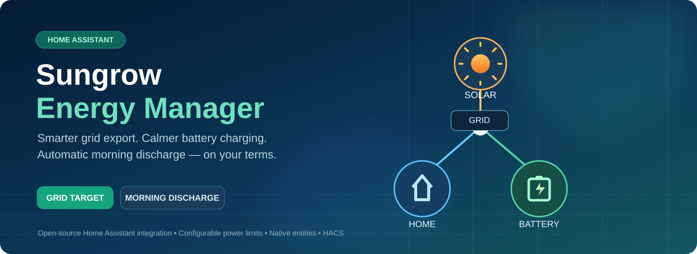

# Sungrow Energy Manager

**Smarter grid export. Smoother battery control. More useful solar energy.**

A Home Assistant custom integration for stepped solar export control and scheduled morning battery discharge on supported Sungrow hybrid inverter systems.

[**Install**](#installation) · [**Features**](#features) · [**Configuration**](#connect-your-sungrow-entities) · [**How it works**](#how-grid-target-works) · [**Troubleshooting**](#troubleshooting)

---

## Turn sunshine into smarter decisions

**Sungrow Energy Manager (SEM)** gives Home Assistant users control over *when* charging limits change rather than continuously reacting to every passing cloud. It monitors actual power exported to the grid and makes measured adjustments only when deviations persist. A second, optional mode can discharge the battery before sunrise or early in the morning to free up capacity for the next solar peak.

This is a **Home Assistant control integration**, not an official Sungrow product. It uses entities already supplied by your Sungrow/Modbus integration and does not replace the inverter's safety functions, BMS protections, or certified grid-export limit.

## Features

| Feature | What you get |
|:--|:--|
| 🎯 **Grid Target** | Aim for a chosen export setpoint without PID oscillation |
| ↔️ **Dead Band** | Ignore fluctuations within a user-defined tolerance |
| ⏳ **Symmetric Delay** | Wait for a sustained deviation before increasing *or* decreasing the charge limit |
| 🔋 **Charge Gain** | Apply a defined charging-power step, respecting number-entity min/max/step |
| ⛅ **Cloud-tolerant operation** | Short changes in solar production do not immediately rewrite the charging limit |
| 🌅 **Morning Discharge** | Optionally schedule one forced-discharge window each day |
| 🛡️ **Backup SOC protection** | Stop forced discharge at the selected Sungrow backup reserve |
| ⚡ **Live discharge power** | Change the forced discharge setpoint while discharge is active |
| 📱 **Native dashboard** | Control setpoints, switches and start time without editing YAML |
| 🧭 **Diagnostics** | See countdown, skipped SOC thresholds and mode failures |
| 🌍 **Localized setup** | Config flow explanations in English, Russian and Hebrew |
| 💾 **History sensor** | 10-second snapshot for a useful charging-limit history graph |

## How Grid Target works

Grid Target is **not a PID controller**. It checks live grid export once per second, but it updates the battery charging limit only after the measured export has remained outside the dead band for the configured time.

| Setting | Typical example | Meaning |
|---|---:|---|
| **Export Target SP** | 10,000 W | Desired grid export |
| **Export Dead Band** | 1,000 W | Tolerance on either side of target |
| **Export Delay Time** | 600 s | Continuous time outside the tolerance |
| **Charge Gain SP** | 3,000 W | Size of a single charge-limit change |

**Example: increased solar output.** Solar production is **14 kW**, home consumption is **1 kW** and the configured export target is **10 kW**. With no battery charging the measured export is about **13 kW**, exceeding the allowed upper band of **11 kW**. If this persists **600 seconds**, SEM increases the battery charging limit by **3 kW**. Under unchanged conditions, export should then move toward **10 kW**.

**Example: a cloud arrives.** Solar production falls to **11 kW** while the home uses **1 kW** and battery charging is limited to **3 kW**. Grid export is approximately **7 kW**. If the export remains below **9 kW** for **600 seconds**, SEM lowers the charging limit by **3 kW**.

### Exact control rules

1. **Export > target + dead band:** start the *increase charge limit* timer.
2. **Export < target − dead band:** start the *decrease charge limit* timer.
3. **Inside the band:** clear the timer and hold the current limit.
4. **Direction changes:** reset the timer and start again in the new direction.
5. **Delay completed:** change the charge limit by one gain step, then start a new observation period if necessary.
6. **Limit reached:** stop counting when the requested adjustment would exceed the charging number's minimum or maximum. Re-arm only when a useful adjustment becomes possible.

The delay is **identical in both directions**, by design. A changing export value can still move far from the target for the entire delay. **Keep the inverter's independent grid export limit configured.**

## Morning Battery Discharge

Enable **Battery Morning Discharge** when you want the battery to reach a lower state of charge before daytime solar production.

| Setting | Example | Description |
|---|---:|---|
| **Morning Discharge** | ON | Enable the schedule |
| **Start Time** | 05:00 | Daily local start time |
| **Empty SOC SP** | 30% | Only start when actual SOC is above this threshold |
| **Battery Forced Discharge Power** | 8,000 W | Requested forced-discharge power limit |
| **Battery Reserved SoC for Backup** | e.g. 20% | Stop threshold read from your selected Sungrow entity |

At the scheduled time SEM checks that Grid Target is enabled, the schedule is ON and actual battery SOC is above both **Empty SOC SP** and the selected **Battery Reserved SoC for Backup**. It sets the chosen forced discharge power number, activates the configured **Battery Forced Discharge** scene, then monitors SOC. When SOC reaches the backup reserve, it activates **Self-Consumption Mode (max battery discharge)** to exit the forced mode.

While forced discharge is active, you can change **Battery Forced Discharge Power**; SEM sends the updated limit to Sungrow immediately instead of waiting for the next scheduled start. Home Assistant accepting a command does not guarantee that the inverter will deliver that exact power: load, inverter logic and BMS limits still apply.

**Important:** Discharge only starts while the main **Grid Target** switch is on, and after a Home Assistant restart you must manually re-enable Grid Target. When a scheduled attempt fails or is skipped, the status sensor records the reason, and changing the scheduled time allows another attempt. The schedule is not a substitute for battery or site electrical protection.

## Installation

### HACS (recommended)

1. In Home Assistant, open **HACS → Custom repositories**.
2. Add `https://github.com/EvgenyKrinets/sungrow-grid-pid` as an **Integration** repository.
3. Install **Sungrow Energy Manager** and **restart Home Assistant**.
4. Open **Settings → Devices & Services → Add Integration**, search **Sungrow Energy Manager** and select the live Sungrow entities.
5. Open the **Sungrow Energy Manager** dashboard, review all settings, and press **START** to enable Grid Target.

The integration keeps the historical domain `sungrow_grid_pid`, the GitHub repository path and existing dashboard URL to support upgrades from previous **Sungrow Grid PID** installations. **Do not install a second copy** over an existing installation.

### Manual installation

Copy the `custom_components/sungrow_grid_pid/` directory into your Home Assistant `config/custom_components/` directory, restart Home Assistant and add the integration through Devices & Services.

## Connect your Sungrow entities

During installation SEM offers Home Assistant entity selectors. For the familiar Sungrow naming scheme below it **automatically suggests a match when exactly one live entity has the matching friendly name and domain**. It does *not* invent entity IDs or select ambiguous matches. You can change any entity in **Settings → Devices & Services → Sungrow Energy Manager → Configure**.

| Setting | Typical entity name shown in Home Assistant | Required for |
|---|---|---|
| Grid export sensor | **Export power** | Grid Target |
| Maximum charge power | **Battery max charge power** | Grid Target |
| Self-consumption scene | **Self-Consumption Mode (max battery discharge)** | Start and return |
| SOC sensor | **Battery level** | Morning Discharge |
| Backup reserve | **Battery Reserved SoC for Backup** | Morning Discharge |
| Forced discharge scene | **Battery Forced Discharge** | Morning Discharge |
| Forced power number | **Battery forced charge discharge power** | Morning Discharge |

The three basic entities have default entity IDs used by prior versions: `sensor.export_power`, `number.battery_max_charge_power` and `scene.self_consumption_mode_max_battery_discharge`. The four morning-discharge selections are discovered by **friendly name** when the corresponding entities exist. If an entity is missing or there is more than one match, select it manually.

**Never select a power entity for backup SOC.** The backup reserve is a percentage between **0 and 100%**. For example, **25,000 W is not 25,000% SOC**.

## Native Home Assistant entities

| Entity ID | Purpose |
|---|---|
| `switch.sem_grid_target` | Run/stop Grid Target controller |
| `number.sem_export_target` | Export Target SP (W) |
| `number.sem_dead_band` | Export Dead Band (W) |
| `number.sem_delay` | Export Delay Time (seconds) |
| `number.sem_charge_gain` | Charge Gain SP (W) |
| `switch.sem_morning_discharge` | Enable scheduled discharge |
| `time.sem_morning_start` | Daily start time |
| `number.sem_empty_soc` | Morning start SOC threshold (%) |
| `number.sem_discharge_power` | Forced discharge power limit (W) |
| `sensor.sem_manager_status` | Grid Target status / adjustment countdown |
| `sensor.sem_morning_discharge_status` | Discharge outcomes and diagnostic messages |
| `sensor.sungrow_pid_charge_history` | Sampled charge command history |

Entity IDs may differ if Home Assistant has created duplicates; always confirm in **Developer Tools → States**.

## Dashboard experience

The dashboard provides an at-a-glance view of **Grid Export**, **Battery Charge SP**, control state, all export settings, the morning schedule and a persistent morning discharge diagnostic. SP inputs display whole watts, seconds and percentage values, with explanatory text beside each control.

The installed dashboard is reachable at `/sungrow-grid-pid` for compatibility with earlier releases. The original PID automation is disabled during the transition so it cannot compete for control with the new manager. Existing user-owned YAML and helper entities are preserved.

## Safety and limitations

- SEM is an independent community project; it is **not affiliated with or endorsed by Sungrow**.
- A 600-second delay can allow export to deviate above or below the target for 10 minutes. **Maintain a separately configured and enforced export limit on your inverter.**
- A charging-power *limit* is not a guarantee of constant battery power. BMS, grid conditions and the inverter retain their own logic.
- Battery reserve, scene transitions and actual forced-power behavior depend on the connected Sungrow entities and their service implementations.
- Test forced discharge with the inverter observable and a known safe backup SOC. Home Assistant does not guarantee an emergency shutdown when offline.
- Missing/unavailable export, charge or SOC inputs may suspend commands and generate diagnostics.
- Backup-reserve selections must be percentage entities. Double-check unit, range and live value before enabling Morning Discharge.

## Troubleshooting

**Morning Discharge did not start:** Check the main Grid Target switch is ON, Morning Discharge is ON, Start Time is the intended local minute, the four discharge entities are selected, and actual SOC is greater than both the Empty SOC SP and backup reserve. Read `sensor.sem_morning_discharge_status` for the reason.

**It says “reserve 25000%”:** The reserved SOC selector points to a power-control entity rather than the backup SOC percentage entity. Correct that selection.

**Settings save but entities become unavailable:** Avoid deleting the integration. Check **Settings → System → Logs** for messages involving `sungrow_grid_pid` and try a normal Home Assistant restart. Include the traceback in a GitHub issue if it persists.

**Card appears outdated after HACS update:** Restart Home Assistant; if frontend assets remain cached, reload the dashboard or refresh the browser.

**The old PID automation is still present:** Existing user-owned YAML is intentionally not deleted. Ensure it remains **OFF** while using SEM.

## Upgrading from Sungrow Grid PID

The package continues to use the legacy internal integration domain for compatibility. HACS upgrades the same repository; you do not need a separate installation. Grid Target replaces the old rapid PID setpoint loop with step-and-delay logic, while the separate snapshot sensor retains the previous charging history functionality.

## Releases & feedback

See the [releases](https://github.com/EvgenyKrinets/sungrow-grid-pid/releases) for changes and [open an issue](https://github.com/EvgenyKrinets/sungrow-grid-pid/issues) for bugs, device compatibility or feature ideas. When reporting an issue, include your Home Assistant version, SEM version, configured entity types (without credentials), and relevant logs.

---

<strong>Sungrow Energy Manager</strong> Own your export strategy. Give your battery room to work.

